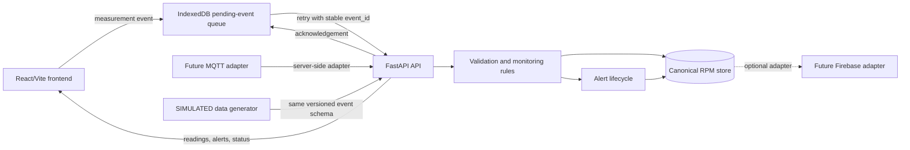

# PahaadCare RPM Architecture Contract

Status: Phase 2A design contract
Contract version: 1.0.0
Scope: Architecture boundaries and data ownership only. No frontend, Firebase, MQTT, or backend implementation is included.

## Decision Summary

PahaadCare will retain the existing React/Vite frontend. A future Python/FastAPI service will be the authoritative boundary for shared RPM data, validation, monitoring rules, and alerts. MQTT and Firebase remain replaceable integration adapters behind that service boundary.

Flutter is not mandatory based on the current repository: the application is React/Vite and no Flutter project or Flutter-specific requirement is present. Flutter migration is deferred unless competition rules explicitly require it; that decision must be made before building a second frontend.

## Component Responsibilities

### React/Vite frontend

- Displays patient records, measurements, alerts, freshness, and synchronization status.
- Submits manually entered or simulator-generated measurement events through the versioned API contract.
- Stores pending outbound events in a future durable offline-storage layer, preferably IndexedDB rather than localStorage.
- Keeps client queue state separate from server delivery state.
- May present server-provided alert decisions, but must not contain privileged credentials or be the authoritative clinical rules engine.
- Continues to own current prototype features such as local patient records, medicines, SOS, language support, and rural-care navigation.

### Python/FastAPI backend

- Authenticates callers and authorizes access by patient, caregiver, clinician, and administrator role.
- Validates event structure, timestamps, identity, source, units, and measurement ranges.
- Persists canonical events and applies configurable monitoring and missing-data rules.
- Creates, deduplicates, acknowledges, and resolves alerts.
- Exposes the API defined in [rpm-api-contract.md](rpm-api-contract.md).
- Provides the integration boundary for MQTT ingestion and Firebase adapters.
- Owns server receipt time, accepted/rejected decisions, and synchronization acknowledgements.

### MQTT adapter

- Future transport for device readings and monitoring events.
- Publishes or consumes validated event-shaped messages through the backend ingestion boundary.
- Must not bypass backend authentication, validation, idempotency, or alert creation.
- Is not required for the initial schema or API work.

### Firebase adapter

- Future shared persistence and authentication option.
- Storage-specific document IDs are implementation details and must not replace `event_id` or `alert_id`.
- Firebase Authentication identities may be mapped to application actor IDs, but authorization remains an application/backend responsibility.
- Firebase is not assumed to be the canonical store until a separate persistence decision is approved.

### Synthetic data generator

- Produces fictional readings for demonstrations and automated tests.
- Uses the same measurement event schema as every other source.
- Sets `source` to `simulator` and `is_simulated` to `true`.
- Must display or preserve the `SIMULATED` label in downstream views and exports.
- Must never be represented as a real medical-device integration or clinical observation.

## Trust Boundaries

1. The browser is an untrusted client. Local storage, client timestamps, queue state, and simulator output can be modified by the user.
2. The HTTPS API is the trust boundary for authentication, authorization, schema validation, server receipt time, idempotency, and alert decisions.
3. MQTT brokers and Firebase are external infrastructure boundaries. Credentials and service accounts stay server-side.
4. Clinician-facing alert status is server data, not a browser assertion.
5. Patient identifiers are references, not authorization. Every patient-scoped request requires authenticated, authorized access.

## Data Flow

## Data Ownership

- The current prototype's localStorage remains the owner of existing demo patient, medicine, report, family, and language data until a migration is approved.
- Future RPM measurements and alerts are server-owned canonical records.
- The frontend may cache server RPM data for offline display, but cached data is not authoritative.
- An offline queue entry is a delivery attempt record, not proof that the backend accepted the event.
- `measured_at` is the source observation time and never changes during retry. `received_at` is assigned by the backend when accepted or recorded when known.

## Versioning and Compatibility

- Measurement and alert schemas use independent semantic contract versions.
- `schema_version` is carried in every measurement event. Alert objects carry `schema_version` as well.
- Additive optional fields are minor-compatible changes. Removing or changing field meaning requires a new major version and endpoint/content negotiation plan.
- The backend must reject unsupported major versions with a structured validation error.

## Security and Clinical Safety

- Use HTTPS, short-lived access tokens, role-based authorization, consent checks, audit logging, encryption at rest, and secret management before real health data is accepted.
- Initial thresholds are software-demonstration defaults, not clinically validated guidance. They require clinician review, versioning, patient-specific configuration, and operational escalation policy before any pilot.
- Generated readings, demo patients, and sample provider listings must remain clearly marked as non-clinical.

## Decisions and Follow-up

See [unresolved-decisions.md](unresolved-decisions.md) for Git, service-worker documentation, ownership files, localStorage coexistence, and Flutter decisions.
