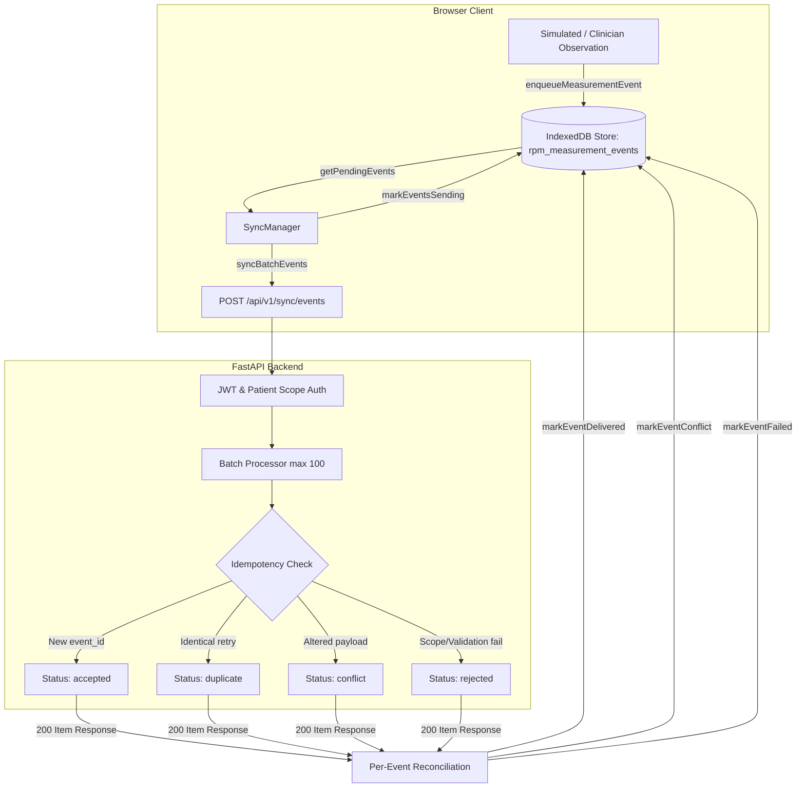

# PahaadCare RPM Durable Offline Event Queue and Synchronization Specification

Status: Milestone 3 Complete Contract  
Database: Browser IndexedDB (`pahaadcare_rpm_offline_db`)  
Synchronization Endpoint: `POST /api/v1/sync/events`  
API Client: `src/rpmApi.js`  
Offline Queue Module: `src/offlineQueue.js`  
Sync Manager: `src/syncManager.js`  
Dashboard Component: `src/RpmDashboard.jsx`  

---

## 1. Overview & Architecture

The PahaadCare RPM offline queue provides client-side durability for physiological measurement events recorded by rural health workers and simulated telemetry. Events created when disconnected or during network instability are persisted in browser IndexedDB, survive tab reloads and browser restarts, and synchronize with the backend once connectivity is restored.

Delivery is designed for **at-least-once delivery with server-side idempotent deduplication**, reconciling each event individually based on the backend batch synchronization contract.



---

## 2. IndexedDB Queue Schema

- **Database Name:** `pahaadcare_rpm_offline_db`
- **Schema Version:** `1`
- **Object Store Name:** `rpm_measurement_events`
- **Primary Key:** `event_id` (`keyPath: "event_id"`)

### Indexes
1. `by_status`: Index on `status` (`pending`, `sending`, `delivered`, `conflict`, `failed`).
2. `by_patient`: Index on `patient_id` (e.g. `PC-SYNTH01`).
3. `by_enqueued`: Index on `enqueued_at` (ISO-8601 UTC timestamp).

### Record Structure
```json
{
  "schema_version": "1.0",
  "event_id": "9b1deb4d-3b7d-4bad-9bdd-2b0d7b3dcb6d",
  "patient_id": "PC-SYNTH01",
  "measurement_type": "heart_rate",
  "value": 78.5,
  "unit": "beats_per_minute",
  "measured_at": "2026-10-22T12:00:00.000Z",
  "source": "patient",
  "is_simulated": true,
  "device_reference": null,
  "health_worker_reference": null,

  "status": "pending",
  "enqueued_at": "2026-10-22T12:00:01.000Z",
  "attempt_count": 0,
  "last_attempt_at": null,
  "error_message": null,
  "server_status": null,
  "delivered_at": null
}
```

### Storage Resilience & Privacy Guarantees
- **No Sensitive Credentials:** Access tokens, passwords, and user authorization secrets are **never** written to IndexedDB.
- **Idempotent Enqueue:** If `enqueueMeasurementEvent` is called with an existing `event_id`, the existing record is preserved without overwriting payload or incrementing attempts.
- **Memory Fallback Store:** If IndexedDB is blocked (private browsing mode) or throws a `QuotaExceededError`, operations fall back gracefully to an in-memory store without crashing the UI.

---

## 3. Event Lifecycle & Delivery States

| State | Durability | Description | Allowed Next States |
|---|---|---|---|
| `pending` | Durable | Measurement event stored locally, awaiting transmission. | `sending` |
| `sending` | Transient Lease | Batch is currently in-flight to `POST /api/v1/sync/events`. | `delivered`, `conflict`, `failed`, `pending` (on error/crash) |
| `delivered` | Durable | Server confirmed receipt (`accepted` or `duplicate`). Safe to prune. | (Terminal / Prunable) |
| `conflict` | Durable (Quarantine) | Server rejected event due to mismatched payload on reuse of `event_id`. | (Quarantined for clinician review) |
| `failed` | Durable (Terminal) | Server rejected event due to permanent validation error or patient scope denial. | (Quarantined, retries halted) |

### Crash & Reload Recovery
If the browser is closed, refreshed, or crashes while an event is in `sending` state:
- Upon database open (`openQueueDatabase`) and sync manager initialization (`syncManager.init`), `resetSendingToPending()` is automatically invoked.
- All orphaned `sending` records are safely restored to `pending`, preventing data loss.

---

## 4. Synchronization Manager (`syncManager.js`)

### Single-Flight Guard
Multiple concurrent sync triggers (online event, dashboard load, user clicking "Sync Now") are consolidated through a single active promise guard. If a synchronization is active, subsequent calls return the existing promise without dispatching overlapping requests.

### Batch Limits
Batches are bounded to `MAX_SYNC_BATCH_SIZE = 100` items to comply with the backend contract and request body payload limits.

### Exponential Backoff with Jitter
For transient network dropouts and HTTP `5xx` server errors:
- **Base Backoff:** 2,000 ms (`INITIAL_BACKOFF_MS`).
- **Growth Factor:** `min(30000, 2000 * 2^(consecutiveFailures - 1))`.
- **Random Jitter:** `±1000 ms` uniformly distributed window to prevent thundering herd against rural backends.
- Failures reset to 0 upon any successful batch delivery or online event.

### Authentication Enforcement
- **401 Unauthorized:** If the API client encounters a session expiration (`SessionExpiredError`), synchronization is immediately paused (`isPausedOnAuth = true`) and retry timers are cancelled. Synchronization resumes automatically when `resumeAfterAuth()` is invoked upon new sign-in.
- **403 Forbidden:** Treated as permanent failure for affected patient events. Does not loop endlessly.

---

## 5. Per-Event Status Reconciliation

HTTP `200 OK` from `POST /api/v1/sync/events` does not imply all events were accepted. Each item in the backend response is reconciled independently:

1. **`accepted`**:
   - Status updated to `delivered`.
   - `server_status` set to `'accepted'`.
   - `delivered_at` set to current timestamp.
   - Associated `alert_ids` attached to record.
2. **`duplicate`**:
   - Status updated to `delivered`.
   - `server_status` set to `'duplicate'`.
   - Treated as successful confirmed delivery; idempotent retry satisfied.
3. **`conflict`**:
   - Status updated to `conflict`.
   - Quarantined with server error explanation.
   - Excluded from future automatic `getPendingEvents` queries.
4. **`rejected`**:
   - Status updated to `failed`.
   - Reason (e.g. `patient_access_denied` or validation error) saved to `error_message`.
   - Excluded from future automatic `getPendingEvents` queries to prevent infinite retry loops.

---

## 6. Account-Switch & Shift-Handover Policy

In rural clinics with shared field tablets:
- When a health worker signs out (`signOut`), the active session token is revoked on the backend and cleared from `sessionStorage`.
- **The IndexedDB offline queue is NOT deleted on sign-out.** Deleting queued data when a worker logs out in an offline area would cause irrecoverable loss of un-synchronized patient readings.
- When the next health worker signs in and network connectivity is available, pending events are dispatched to the backend. The backend enforces patient-level authorization for the submitting credentials.

---

## 7. Known Limitations & Future Work

1. **Background Sync API:** Current sync triggers rely on browser page visibility and `online` event listeners. True background sync via Service Worker / Periodic Background Sync is reserved for progressive web app hardening in future milestones.
2. **Automatic Conflict Merging:** Conflicting event payloads are strictly quarantined to preserve clinical data integrity and require manual operator inspection. Automated merge strategies are not supported.
3. **Storage Quotas:** Browser-enforced storage quotas apply per origin; very high frequency telemetry requires periodic pruning of `delivered` events via `clearDeliveredEvents()`.
